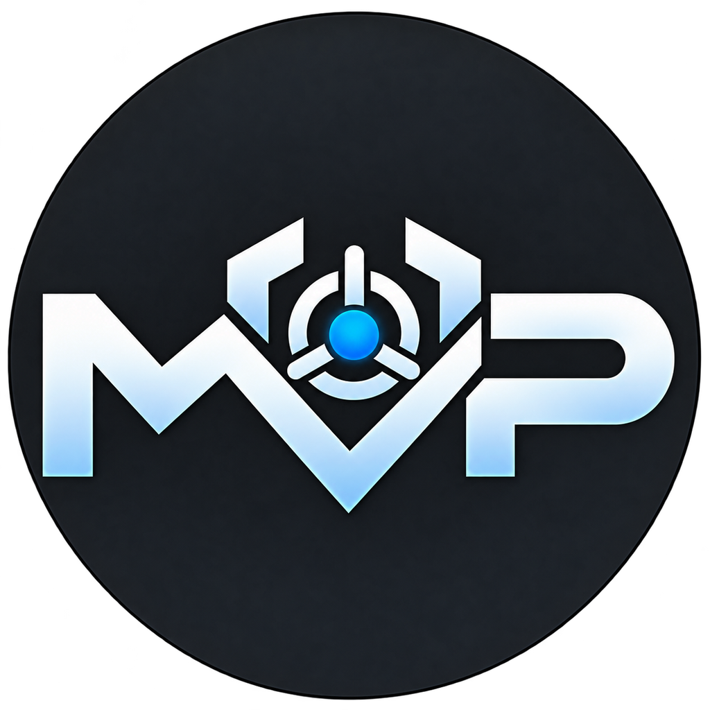
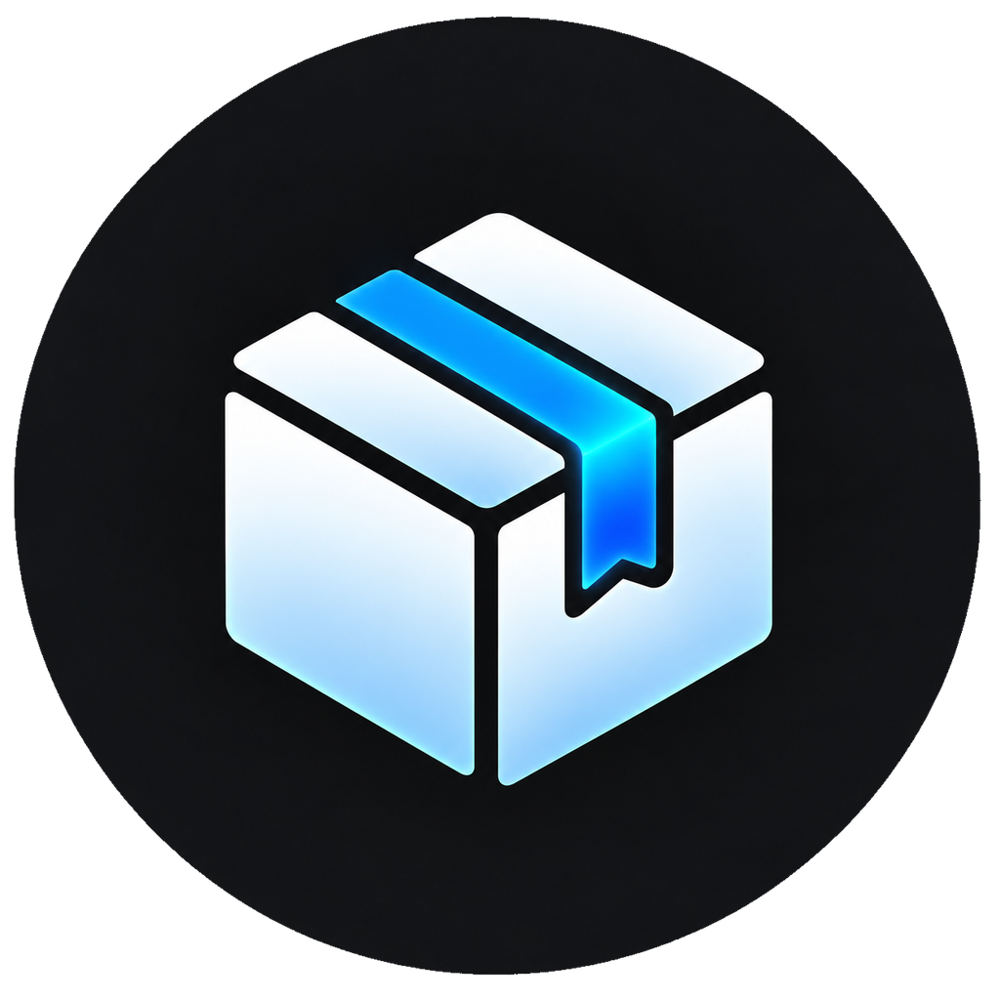

<div align="center">



# Mega Vault Protect

<p align="center">
  
</p>

[](https://en.cppreference.com/w/cpp/20)
[](https://www.qt.io/)
[](https://kotlinlang.org/)
[](https://www.zetetic.net/sqlcipher/)
[](https://en.wikipedia.org/wiki/Argon2)
[](https://doc.libsodium.org/)
[](https://ffmpeg.org/)
[](https://cmake.org/)

</div>

---
<div align="center">

[]() &nbsp;
[]() &nbsp;
[]()

**[What it is](#what-it-is)** · **[Library](#library)** · **[Phone and PC](#phone-and-pc)** · **[Security model](#security-model)** · **[Downloads](#downloads)** · **[Build & run](#build--run)**

</div>

Mega Vault Protect is a private library for the files on your computer or phone. The vault is locked with a password you choose. Every imported file is stored as an authenticated encrypted package on that device. The same C++ core runs the Windows and Linux app and the Android app.

The filename is not the type. The app reads the file header. It uses the extension only when the header is not a known type. A RAR named `.mp4` stays a RAR.

## What it is

Import accepts any file, one at a time or a whole folder. Dropping files on the Windows library does the same.

| What you imported | What the app does |
|---|---|
| Video | Plays it from the encrypted package. Playback reads only the chunks it needs. |
| Picture | Opens it in the viewer. Drag moves the picture. The wheel or a pinch zooms toward the pointer. |
| Music | Opens the music player. On Android it keeps playing from the notification. |
| PDF | Opens the page viewer. Pinch or the wheel zooms. Double-tap switches between fit and a closer view. |
| Text | `.txt`, `.json`, notes, and other plain-text files open in a reader in the same window. |
| Anything else | Stays in the library. The tile shows a stable color for that type, a label such as `[ Rar ]`, and the size. Opening it shows **this format currently not supported**. The file is not deleted and is not sent to another app. |

Local-vault video, pictures, and music are decrypted in memory for viewing. On Android, the PDF viewer writes the open document into the app cache because the system PDF renderer needs a file. That cache file is the open document, not the vault copy. Desktop note saving currently uses a temporary plaintext file before importing it; cloud clients also cache decrypted files locally. These exceptions and cleanup limitations are described in [SECURITY.md](SECURITY.md).

## Library

Folders are names inside the vault. The encrypted packages stay where the vault put them. Removing a folder deletes the files and folders inside it, after a confirmation when anything is there.

On desktop, **New record** creates a text item in the current folder: a title plus any number of name/value pairs — an API key, a password, an e-mail address, a note. Values can be marked secret; a secret stays masked until you reveal or copy it, and a copied secret is cleared from the clipboard after 30 seconds. The app works out how to present each value (a URL, an e-mail address, a password, a number, or a longer text) from the value itself, so there is no type to pick. A record is encrypted and stored exactly like an imported file, so it sits in folders, carries tags, and is found by search. Like every other item, it is recognised by its content, not by its name. Android does not have the desktop record editor.

The library has three views: large icons, a list, and a details table. Search matches the file name or a tag. Tags are edited in Settings. The vault locks after 5 minutes without use. Changing the password re-wraps keys and re-encrypts thumbnails. It does not re-encrypt the packages. Removing an item deletes its package.

On Android, Back walks up one folder. At the library root, a second press within two seconds leaves the app. The video player starts fullscreen, fades the title, seeks ±5 seconds on a double tap, and plays at 2× while a side is held. The timeline shows the buffered region.

## Packages



**Export package** writes one `.mvpk` file holding the selected items or a folder, locked with a password you choose for that file — it is separate from the vault password. **Import package** asks for that password and adds the contents to the current folder as new items. Nothing is uploaded; the file moves only where you copy it.

On the desktop, a package carries the icon above and opens straight into the import prompt. Windows gets the type on first run, under `HKEY_CURRENT_USER\Software\Classes`, so it needs no elevation. In the Linux release archive, `./install-desktop-entry.sh` installs the same association plus the menu entry and icons.

## Phone and PC

Sharing and swapping need both devices on the same network. The self-hosted cloud, described at the end of this section, does not.

**Open the PC vault on the phone.** Share on the PC shows a QR code. The code contains the address and the fingerprint of that session’s TLS certificate. The phone checks the certificate before it sends the vault password. Locking the PC window does not stop sharing. Stopping share does.

**Swap libraries.** From the phone, Swap with PC asks the PC to accept. After that, each side can browse the other’s library and copy items into its own. Neither side can rename, move, or delete the other’s files.

Copies wait in a queue and run one at a time, because the vault writes one package at a time. You can leave the other library, open your own, and add more copies while a transfer is running. **Transfers** lists what is copying and what is waiting. Cancel removes a waiting item immediately, and stops the item that is currently copying.

### Optional self-hosted sync

Sync keeps a local vault on each device and transfers end-to-end encrypted
packages through your own relay. An account decides which vault you attach to;
your vault password never leaves the device and is what decrypts the packages.
The relay stores each file as an opaque package and keeps one small record per
item — name, folder, tags, version — so names and folders are visible to the
operator while the bytes are not. A conflict keeps both items, and a delete is
a reversible tombstone until you purge it.

The server is a single folder: `sync_server/` holds the relay, its web console
(`web/`), the tests and the TLS deployment (`deployment/`). Packing it is
`python scripts/package-server-release.py --output server.zip`; installing it is
copying that one folder to the host.

See [the server and its wire contract](sync_server/README.md),
[deployment with TLS](sync_server/deployment/README.md) and the
[protocol 4 design](docs/sync-mega-plan.md). The desktop app and the relay speak
protocol 4; the phone client is still the older protocol 3 hash bucket and does
not work against a protocol 4 relay yet. Documents describing protocol 3 are
marked historical. This replaces the old trusted-server `MegaVaultCloud`
workflow, not PC/LAN sharing.

## Screenshots

The pictures below are the library and the video player. Pictures, music, PDFs, and phone sharing are in the app and are not in these shots.

### Windows

| | |
|---|---|
| **Icons** — thumbnail grid, search, and sort. | **List** — name, size, and cover. |
|  |  |
| **Details** — size, duration, resolution, codec, tags, imported time. | **Player** — playback of an imported video, with previous/next, seek, volume, and fullscreen. |
|  |  |

### Android

<p align="center">
  
  
  
</p>

## Downloads

Each [GitHub Release](https://github.com/XCisCoX/Mega-Vault-Protector/releases) has three files:

| File | How to run it |
|---|---|
| `MegaVaultProtect-windows-x64.zip` | Unzip and run `MegaVaultProtect.exe`. |
| `MegaVaultProtect-linux-x64.tar.gz` | Extract and run `./MegaVaultProtect.sh`. Needs glibc 2.39 or newer (Ubuntu 24.04). `./install-desktop-entry.sh` adds the menu entry, icons, and the `.mvpk` type. |
| `MegaVaultProtect-android-arm64.apk` | Install on an arm64 phone running Android 8 or newer. |

Create another release from Actions → **Release** → Run workflow, or push a tag such as `v0.4.0`.

The Windows and Linux app can update itself. When GitHub has a newer compatible release, an update icon appears in the library toolbar. Click it to download the package, then choose **Restart and install** to replace the app and launch the new version. The application directory must be writable. Android's update button downloads the APK and opens the system installer for approval.

The Android release package is signed with one project release key, so newer releases install over copies signed with that key. Installs using the old per-build CI keys (from before the signing change on 2026-10-14) need a one-time uninstall and reinstall. **Preserve any vault data you need before uninstalling: Android can remove the app's local vault.** Local debug APKs use a different key and are not release-compatible. See [Android signing](docs/ANDROID-BUILD.md#signing-android-releases).

## Security model

- The master key comes from the password with **Argon2id** (8 MiB–1 GiB memory, 1–20 iterations, 1–16 lanes).
- Domain-separated subkeys (libsodium `crypto_kdf`) cover the database, the password verifier, file-key wrapping, and thumbnails.
- The vault database is **SQLCipher** (4096-byte pages, HMAC-SHA512, `secure_delete ON`).
- Each imported file is a `.vvp` package: a random 256-bit file key, wrapped under the vault key, split into chunks, and authenticated per chunk. A seek verifies the chunks it reads.
- Creating a vault is crash-consistent: the database is written to a temporary file, flushed, renamed into place, and only then is the ready marker written.
- Key material is held in libsodium guarded memory and wiped on release. Wiping is best effort.

## Platforms

- **Linux x64** — Ubuntu 24.04 (GCC 13, Qt 5.15, distro FFmpeg 6.1 / SQLCipher / Argon2 / libsodium).
- **Windows x64** — MSVC 2022, Qt 5.12.12, pinned vcpkg dependencies.
- **Android (arm64-v8a)** — Kotlin and Jetpack Compose, with the same core through JNI. CI installs the pinned NDK and SDK packages; local native cross-builds can use the documented NDK container.

Platform-specific code is the file I/O (`_WIN32` vs POSIX), dependency discovery (vcpkg vs pkg-config), the JNI bridge, and the phone and desktop UI. The Release workflow builds all three and runs the test suites on Windows and Linux before it publishes.

## Build & run

### Linux (Ubuntu 24.04)

```text
sudo apt install qtbase5-dev qtmultimedia5-dev libqt5multimedia5-plugins \
  libavcodec-dev libavformat-dev libavutil-dev libswscale-dev libswresample-dev \
  libsqlcipher-dev libargon2-dev libsodium-dev libssl-dev \
  gstreamer1.0-plugins-base gstreamer1.0-plugins-good

cmake --preset linux-debug            # or linux-release
cmake --build --preset linux-debug -j "$(nproc)"
ctest --preset linux-debug --output-on-failure   # all nine suites, headless

out/build/linux-debug/qt-app/MegaVaultProtect    # run
```

Audio output needs Qt 5 Multimedia's GStreamer backend (`libqt5multimedia5-plugins` + base/good plugins).

### Windows

From a Visual Studio developer shell with Qt 5.12.12 (msvc2017_64) and the vcpkg manifest installed:

```text
cmake --preset vs2022-x64
cmake --build --preset vs2022-x64-debug
ctest --preset vs2022-x64-debug
```

The vcpkg FFmpeg port installs stub import libraries. Re-run `scripts/regenerate-ffmpeg-importlibs.sh` after a FFmpeg reinstall. FFmpeg 7.x headers have no `extern "C"` guards, so the sources wrap every include.

### Android

The phone app is Kotlin and Jetpack Compose. The core is compiled for arm64-v8a and exposed through `android/app/src/main/cpp/jni_bridge.cpp`. The vault is in the app sandbox. Import uses the system picker (`*/*`, plus gallery and music shortcuts). Video and music play through the streaming reader.

```text
# Cross-compile the dependencies and core for arm64-v8a (pinned NDK container):
docker run --rm --user root -e HOST_UID="$(id -u)" -v "$PWD":/repo \
  saschpe/android-ndk:36.1-jdk25.0.3_9-ndk30.0.14904198-cmake3.31.6 \
  bash scripts/android/build-android-core.sh

# Build the APK with Gradle on a host with the Android SDK, pointing at that prefix:
cd android
MVP_ANDROID_PREFIX="$(cd .. && pwd)/out/android-arm64/prefix" ./gradlew assembleDebug
adb install -r app/build/outputs/apk/debug/app-debug.apk
```

A local build is debug-signed. The release APK comes from CI, which signs it with the project key, and that is the one the in-app updater installs.

Full SDK prerequisites, build procedure, and signing: [docs/ANDROID-BUILD.md](docs/ANDROID-BUILD.md). CI builds on pushes and pull requests targeting `main`, and on manual runs (`.github/workflows/android-build.yml`). Release builds require the project signing key; secret-free CI runs can produce debug APKs instead.

### Tests

`ctest` runs nine headless suites. Windows and Linux release builds run the same list before a release is published.

| Suite | What it checks |
|---|---|
| `VideoVaultCore.Smoke` | Create and open a vault. A wrong password is rejected. |
| `VideoVaultCore.Gallery` | Import, list, and export round-trip. |
| `VideoVaultCore.Admin` | Password change re-keys the vault. Removal deletes the package. |
| `VideoVaultCore.Reader` | Streaming reads, seek, and tamper detection on a `.vvp` package. |
| `VideoVaultCore.Media` | Probe, thumbnail after import, and thumbnail survival across a password change. |
| `VideoVault.Playback` | Headless decode through the encrypted reader: duration, frames, seek, and audio. No temp file. |
| `VideoVaultCore.Tags` | Add, filter, rename, and remove tags. |
| `VideoVaultCore.Records` | Create a record from memory, read it back, replace its content in place (same id, folders and tags kept, old package gone), and reject bad names or unknown targets. |
| `VideoVaultRecords.Format` | The record container: marker at byte 0, escaping round-trip, a file of records, nested objects and arrays, secrets by path at any depth, sorted keys, number normalisation and the values it refuses, and the refusals for versions 1/2, booleans and null. |

```text
ctest --preset linux-debug --output-on-failure
ctest --preset vs2022-x64-debug
```

## Project layout

```text
core/        C++20 library: crypto, SQLCipher, .vvp packages, streaming
             reader, FFmpeg probing, thumbnails, tags, folders, text records
qt-app/      Qt 5 app: library, viewers, player, records, text, share,
             transfers, cloud browser, in-app updater; plus the
             MegaVaultCloud server executable
android/     Kotlin + Jetpack Compose app over the same core
tests/       Headless ctest suites
scripts/     Android cross-build, Linux release packaging, icon generation,
             Windows FFmpeg import libraries, next-version tag
third_party/ vcpkg overlay ports (Windows)
docs/        ANDROID-BUILD.md, cloud-ssl.md, architecture.md, screenshots,
             branding masters and logo
.github/     Release, beta, Android build and CodeQL workflows
```

## Tech stack

C++20 · Qt 5 (Widgets, Multimedia) · Kotlin + Jetpack Compose · JNI · Argon2id · libsodium (XChaCha20-Poly1305, crypto_kdf) · SQLCipher · FFmpeg · CMake · Gradle (Android) · vcpkg (Windows) / pkg-config (Linux)
